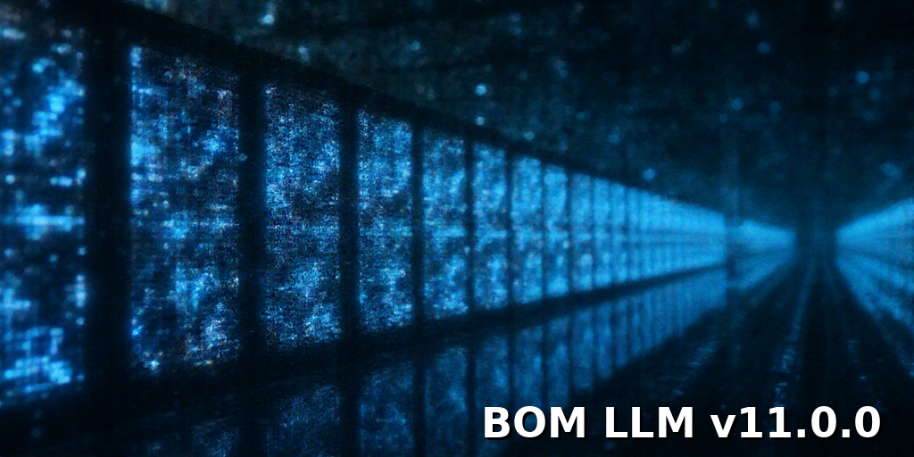
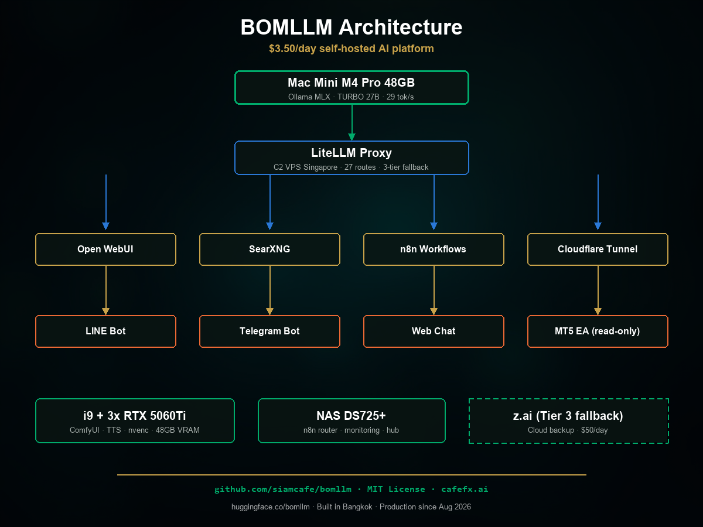
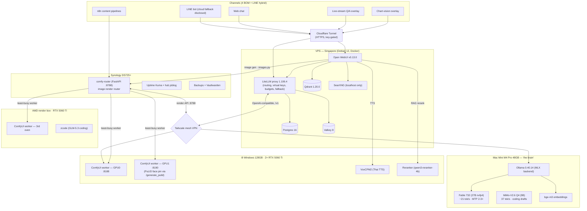

# BOM LLM — Self-Hosted Thai AI Infrastructure




**BOM LLM v12.0.0 — Fleet Audit + Stability: OWUI v0.13.0, Ollama v0.40.14, GOD BLUEPRINT v5.2**

[](https://opensource.org/licenses/MIT)
[]()
[]()
[]()
[]()
[]()
[]()
[]()
[](https://huggingface.co/bomllm/turbo-thai-config)

I replaced $50/day of cloud LLM bills with a Mac Mini on my desk running at $0.54/day measured electricity.
It now does **inference, coding, image generation, voice synthesis, music, and live streaming** — all self-hosted.

One **Mac Mini M4 Pro 48GB** runs TURBO-Fable (27.78B nvfp4 MLX) at **17–20 tok/s** (avg 18.5, verified 2026-10-25).
A **MiMo-V2.6 Q4 (9B)** runs alongside at **37 tok/s** for local coding drafts.
**GLM-5.3** on cloud handles production coding with 71/72 benchmark score.
An i9 with 2× RTX 5060 Ti renders images (ComfyUI + FLUX), Thai voice (SiangTTS), and music (YuE2 + ACE-Step).
Everything meshes over **Tailscale**; public HTTPS via **Cloudflare Tunnel**; every API key-gated.

This is not a demo. This is the exact stack that answers my customers every day.

## Architecture

Full fleet architecture and policies live in [BLUEPRINT.md](BLUEPRINT.md) (GOD BLUEPRINT v5.2 — hardware inventory, role assignment, dependency maps, C2 performance Phase P with measured evidence) and [HOWTO.md](HOWTO.md) (GOD HOW-TO v4.2 — daily sweeps, incident recipes §3.8-§3.17). Locked generation parameters: [GOD_CONFIG.md](GOD_CONFIG.md) (v9.0).

## What's New in v12.0.0 — 🔍 Fleet Audit + Stability (Nov 5, 2026)

- **Grok 4.7 full fleet audit** — 8/8 machines verified (art#56080)
- **ComfyUI fleet** — ALL v0.43.0 (7 instances synchronized)
- **Kuma monitoring** — v2.5.7 deployed on AM4 + NAS
- **Chat residuals FIXED** — keepalive timeout + web-search config corrected
- **LiteLLM incident 30** — emergency model restore completed (28 models OK)
- **Stale job cleanup** — 8 orphaned RUNNING jobs resolved
- **Memory defrag** — consolidated project memory for next phase
- Core versions unchanged: OWUI v0.13.0, LiteLLM v1.106.4, GOD CONFIG v9.0

## What's New in v11.0.0 — ⚡ C2 Performance Update (Nov 4, 2026)

- **Open WebUI v0.13.0** — upstream security fixes, 3 new migrations, 18 functions verified operational on the shared BOMLLM+BOMAI instance
- **C2 performance survey + fix** — external TTFB measured properly (AM5 10-shot median 0.093 s), SSH brute-force guard persisted to boot, LiteLLM DB-load keys verified at GOD CONFIG v9.0 target, pollers audited
- **SSH guard policy** — `/etc/c2-ssh-guard.list` + idempotent systemd unit; NEVER-BLOCK ranges enforced in the script
- **GOD BLUEPRINT v5.2 + HOW-TO v4.2** — new §3.13-§3.17 ops recipes (guard maintenance, LiteLLM DB checks, poller policy, external TTFB measurement, headless QC)
- **GOD CONFIG v9.0 unchanged** — 7/7 locked params verified live (bom-thai-chat, bomai-safe)
- **Residuals closed** — `charming_gauss` removed, squid tailscale-rebind automated, `/static/bomai/` hero banners serving 200
- **IRON Rules 43** — IRON 42 (title format) + IRON 43 (structured reply) added
- **Fleet 8/8 verified + Stress 7/8 PASS** — 8 tailscale peers; T3 web-search passed on retry at 106.6 s (180 s window)

## What's New in v10.0.0 — 🔄 OWUI v0.12.5 Fleet Update (Nov 2, 2026)

- **Open WebUI v0.12.4 → v0.12.5** — 18 mods intact, 14 overlays rebased, 12/12 QC PASS
- **Theme Designer Pro 1.8.0 → 1.19.0**
- **docker-compose.yml pinned to production** — OWUI v0.12.5, LiteLLM v1.106.4, Qdrant v1.20.0
- **Fleet cleanup** — old containers removed, orphan skill IDs cleared, Docker pruned 6.4 GB
- **GOD CONFIG v7.0 NO CHANGE** — locked params verified across 15 models
- **Hero banner v10** — [images/hero_banner_v10.png](images/hero_banner_v10.png)

## What's New in v9.0.0 — 🏁 Project Closure Release (Nov 1, 2026)

- **PROJECT CLOSURE 10/10** — all 14 findings resolved, fleet 8/8 verified, pipeline E2E PASS
- **IRON 40 Rules** — 3 new safety rules (IRON 38/39/40) after SSH incident #24
- **SSH Incident #24 Fixed** — PasswordAuthentication restored on all 8 fleet machines
- **Grok Deep Root Cause Scan** — 8 machines × 9 areas, 3 root causes traced (hardware/config, not software)
- **FINAL BLUEPRINT** — 51KB, 15 sections, comprehensive fleet architecture reference (art#54961)
- **FINAL HOW-TO** — 32KB, 14 sections, complete operational manual (art#54962)
- **Mega Closure Report** — 14/14 findings verified and closed (art#55017)
- **Pinned versions verified** — LiteLLM v1.106.4, OWUI v0.12.4, Ollama 0.40.10-0.40.13, ComfyUI v0.43.0

## What's New in v0.8.1 — 🛡️ GOD CONFIG Docs + QC System (Oct 31, 2026)

- **GOD_CONFIG.md** — full GOD CONFIG v7.0 reference (locked params, per-model compliance, protected deviations)
- **QC System on AM4** — OCR / Whisper / ASR / Gateway, deployed Oct 31, 10/10 PASS
- **Grok deep survey** — 30 findings across 7/7 machines; fleet fixes F001–F010 applied
- **K3 LFM3 lightweight model blueprint** — Typhoon2-3B rank 1, lfm3:1.7b rank 2 (deployed)
- **Pinned versions** — LiteLLM v1.106.4 (⛔ v1.107.0 COMPROMISED), ComfyUI v0.43.0 fleet-wide

## What's New in v0.8 — 🔧 Mega Tuning & Fleet Optimization (Oct 30, 2026)

- **GOD CONFIG v7.0** — 9 parameter corrections across 5 model configurations, all presence_penalty=0 enforced
- **Fleet cleanup** — 210.43 GB reclaimed across UA, AM4, Mac, C2, NAS
- **Ollama 0.40.13** — UA and AM4 upgraded (Mac stays 0.40.10 for production stability)
- **bomai-safe deployed** — content rewrite model on UA and AM4
- **Dead route cleanup** — 9 live + 3 staged removals across LiteLLM instances
- **Docker cleanup** — 15 unused images removed (19.33 GB reclaimed)
- **Auto-start fixes** — i9 llamacpp-gpu1 Automatic, NAS nas-hub unless-stopped
- **Model inventory** — 10 orphan model paths + 1 stale Ollama tag removed
- **Fleet expanded** — 8 machines documented (added UA, AM4, CAT)

### Previous: v7 — 🔒 Security & Fleet Update (Oct 27, 2026)
 — 🔒 Security & Fleet Update (Oct 27, 2026)

- **GOD CONFIG v7.0** — 9 production config changes (Ollama 0.40.10, router truth, rollback containers)
- **Open WebUI v0.12.4** — upgraded from v0.11.3 (Python 3.12.15, Pillow 13)
- **LiteLLM v1.106.3** — security patched; v1.107.0 supply-chain compromise blocked
- **Ollama 0.40.10** — upgraded from 0.40.1 (versioned LaunchDaemon pattern)
- **Qdrant v1.20.0** — upgraded from 1.19
- **Fleet cleanup** — 33.2GB freed across 6 machines
- **SWAP optimized** — UA 2114→320GB, AM4 837→320GB (~2.3TB NVMe reclaimed)
- **think=false routing** — 21 LiteLLM routes patched

### Previous: v6 — 🇹🇭 TURBO-Fable Release (Oct 25, 2026)

**Current production model: TURBO-Fable**
`DavidAU/Qwen3.8-27B-TURBO-Fable-Cold-Fusion-735-882-Heretic-Uncensored-NM-DAU`

| Spec | Value |
|------|-------|
| Parameters | 27.78B (27,781,081,984) |
| Layers | 1,204 |
| Format | MLX nvfp4 |
| Size | 21.58 GB |
| GGUF | Q4_K_M 18.50 GB |
| Context | 8,192 tokens |
| Max Predict | 4,096 tokens |

### Benchmark Results (Verified)

**Thai Language Gate — 20/20 = 1.00 ✅**
- 10 questions, all scored 2/2
- Thai character range: 292–1,064 per answer
- Han (Chinese) leak: **0** on every question

**Han Leak Test — 0/5 = 0.00 ✅**
- 5 dedicated leak probes
- Zero Chinese characters in any response

**Street Test — 3/3 PASS ✅**
- Thai chars > 50 per response
- Han chars < 3 per response
- Byte length > 200 per response

**Inference Speed**
- Average: **18.5 tok/s** (range 17–20)
- Hardware: Apple M4 Pro (Mac Mini), MLX nvfp4

### Recommended Parameters (GOD CONFIG v9.0 locked_params)

```yaml
temperature: 0.6
top_p: 0.95
top_k: 20
repeat_penalty: 1.0
presence_penalty: 0.0
num_ctx: 8192
num_predict: 4096
```

Full bench data: [benchmarks/turbo_fable_bench.yaml](benchmarks/turbo_fable_bench.yaml) · Config: [configs/config_g_v7.0.yaml](configs/config_g_v7.0.yaml)

Promo art (ComfyUI · flux1-dev-fp8 · 1024×1024): [1](images/bomllm_promo_00001_.png) · [2](images/bomllm_promo_00002_.png) · [3](images/bomllm_promo_00003_.png)

## What's New in v5

### 🇹🇭 Fable 732 production swap (Oct 10, 2026)
- **Fable 732** (DavidAU Fable-735-882, nvfp4 MLX, digest `5bd9e2dc6f01`) replaces Fable 709-L under the same `qwen38-uni` tag
- 40-prompt bench: **Thai 20.8 tok/s · English 21.5 tok/s · Han 0/40 direct** (LiteLLM path: 1/40 leaked, fix tracked)
- [v5 benchmark card](images/benchmark_732.png) · [Han detail](images/benchmark_732_han_detail.png) · [bench JSON](benchmarks/v5_732/bench_v5_results.json)

## What's New in v4

### 🧠 Coding Stack (NEW)
- **GLM-5.3** (cloud) — Primary coding model: 71/72 benchmark, 8/8 tasks runnable
- **MiMo-V2.6 Q4** (local 9B) — Draft accelerator: 37 tok/s, zero network latency
- **Verified benchmark:** 8 real coding tasks (Python, MQL5, WordPress, Bash, Node.js)
- **Rule:** MiMo output never ships without test verification or GLM/human review
- [Full benchmark report →](bench/mimo_vs_glm_v1/README.md)

### ⚡ Turbo Inference
- **Fable 732** (DavidAU Fable-735-882, Qwen3.8-27B base) — nvfp4 MLX
- **MTP speculation** — 2-3× effective throughput, acceptance 0.63-0.79
- **Thai quality: 2.00** — zero Han leak, completion-gated + stacked-mark
- think=true mode available (clean Thai reasoning)

### 🎙️ Production Channels
- **5 channels + LINE bot** — web chat, n8n content pipelines, live-stream Q/A overlay, chart-vision overlay, LINE (cloud fallback disclosed)
- **Live stream overlay** — Restream chat → vision analysis → 4-line Thai response → Browser Source
- **Chart analysis** — CDP capture → 732 vision → real-time commentary

### 🎵 Creative Tools
- **Image:** ComfyUI + FLUX Dev fp8 (3 GPU workers via comfy-router)
- **Voice:** SiangTTS (VoxCPM2 LoRA, reference-only mode)
- **Music:** YuE2-3B instrumental + ACE-Step 1.5 Thai vocal

## GOD CONFIG v9.0

Locked generation parameters for all production models:

| Parameter | Value | Reason |
|-----------|-------|--------|
| temperature | 0.6 | Thai quality gate — ≥0.7 fails |
| top_p | 0.95 | Balanced sampling |
| top_k | 20 | Focused vocabulary |
| repeat_penalty | 1.0 | No repetition bias |
| presence_penalty | 0.0 | ⛔ CRITICAL — 1.5 causes Han leak |
| num_predict | 4096 | Max generation length |
| num_ctx | 8192 | Context window |

⛔ **DO NOT change presence_penalty from 0.0** — values >0 cause Chinese character leakage in Thai responses.

Full per-model compliance table and protected deviations: [GOD_CONFIG.md](GOD_CONFIG.md)

## Architecture





## Coding Benchmark

> MiMo-V2.6 Q4 (9B local) vs GLM-5.3 (cloud) — 8 identical tasks, no system prompt

| Model | Score | Runnable | Avg Time |
|-------|-------|----------|----------|
| MiMo-V2.6 Q4 (local) | **49/72** | 2/8 | 66.3s |
| GLM-5.3 (cloud) | **71/72** | 8/8 | N/A |

**MiMo safe zone:** Simple Python drafts with test assertions, scaffolding under review
**Keep on GLM:** MQL5/EA, WordPress/PHP, Bash, timing-critical code, review-free deliverables

[Detailed benchmark results →](bench/mimo_vs_glm_v1/)

## Cost

| Item | Monthly | Daily |
|------|---------|-------|
| Mac Mini M4 Pro electricity | ~$16 | $0.54 |
| VPS (Singapore) | $12 | $0.40 |
| Cloudflare (free tier) | $0 | $0 |
| Tailscale (free tier) | $0 | $0 |
| **Total self-hosted** | **~$28** | **~$0.94** |
| Cloud API equivalent | ~$1,500 | ~$50 |

**Savings: ~98% vs cloud API**

## Quick Start

```bash
git clone https://github.com/siamcafe/bomllm.git
cd bomllm
./scripts/bootstrap.sh
```

## Fleet

| Machine | Role | Key Specs |
|---------|------|-----------|
| Mac Mini M4 Pro | Brain (Primary Inference) | 48GB, Ollama 0.40.14, TURBO-Fable + MiMo Q4, MLX nvfp4 |
| C2 VPS Singapore | Gateway (Frontend) | Docker, OWUI v0.13.0, LiteLLM 1.106.4, SearXNG |
| UA Ubuntu | Primary Inference + Staging | 123Gi, RTX 5080 16GB + RTX 5060 Ti 16GB, Ollama 0.40.14, gpt-oss-120b, LiteLLM staging |
| AM4 Ubuntu | ComfyUI Primary + Hub | 121Gi, 2x RTX 5060 Ti 16GB, Ollama 0.40.13, ComfyUI x2, hub services |
| i9 Windows | GPU Worker | 128GB, 2x RTX 5060 Ti, ComfyUI, TTS, Music, EA |
| AM5 Windows | Coding + Render | zcode GLM-5.3, ComfyUI 3rd worker |
| NAS DS725+ | Infra | comfy-router, monitoring, n8n, backups |
| CAT Server | Web Hosting | DirectAdmin, 5 WordPress sites, MySQL |

## Fleet Status (Nov 4, 2026)

| Machine | Role | Ollama | Status |
|---------|------|--------|--------|
| Mac Mini M4 Pro | Production qwen38-uni | 0.40.14 | ✅ LIVE |
| Ubuntu AI (UA) | gpt-oss-120b + ComfyUI | 0.40.14 | ✅ |
| AM4 | QC Stack + Hub | 0.40.13 | ✅ |
| C2 (Contabo) | OWUI + LiteLLM | — | ✅ |
| i9 | ComfyUI + MT5 + llama.cpp | — | ✅ |
| AM5 | Command station | 0.40.13 | ✅ |
| NAS | Hub relay + n8n | — | ✅ |
| CAT | Web hosting (DirectAdmin) | — | ✅ |

Production pipeline: OWUI v0.13.0 → LiteLLM v1.106.4 → llm-smart → gpt-oss-120b

## QC System (AM4)

Deployed Oct 31 — 10/10 PASS:
- QC Ollama :11440 (GPU0 isolated) — 4 models
- QC Whisper :18091 (typhoon-whisper-turbo)
- QC ASR :18092 (typhoon-asr-realtime, CPU)
- QC Gateway :18090 (LAN accessible)

## Pinned Versions

- OWUI: v0.13.0
- LiteLLM: v1.106.4 (⛔ v1.107.0 COMPROMISED)
- Ollama: 0.40.14 (Mac server + UA), 0.40.13 (AM4)
- Qdrant: v1.20.0
- ComfyUI: v0.43.0 (fleet-wide)
- BOM AI: v3.0.0
- IRON Rules: 43

## License

MIT — clone, run, deploy. See [LICENSE](LICENSE).

## Contributing

See [CONTRIBUTING.md](CONTRIBUTING.md).

---

---

## Keywords

`Thai LLM` `self-hosted AI` `Mac Mini M4 Pro` `local inference` `TURBO-Fable` `BOM LLM` `Thai NLP` `fleet management` `ComfyUI` `FLUX` `open-source AI` `MLX` `Ollama` `LiteLLM` `Open WebUI` `GOD CONFIG` `production AI` `self-hosted ChatGPT alternative` `Thai language model` `low-cost AI inference` `IRON rules` `AI operations` `fleet automation`

## 🇹🇭 ภาษาไทย

**BOM LLM v12.0.0 — Fleet Audit + Stability**

แทนที่ค่า API คลาวด์ \$50/วัน ด้วย Mac Mini บนโต๊ะ \$0.54/วัน (ค่าไฟจริง)

ตอนนี้ทำได้ครบ: ตอบแชท, เขียนโค้ด, สร้างรูป, สร้างเสียง, สร้างเพลง, ถ่ายทอดสด — ทั้งหมดรันเครื่องตัวเอง

**v12.0.0 ใหม่:**
- ตรวจสอบ fleet ครบทั้ง 8 เครื่อง (Grok 4.7 full audit)
- ComfyUI ทั้ง fleet เป็น v0.43.0 เหมือนกันหมด (7 instances)
- Kuma monitoring v2.5.7 บน AM4 + NAS
- แก้ chat residuals — keepalive timeout + web-search config
- LiteLLM incident 30 — กู้คืน models ครบ 28 ตัว
- เวอร์ชันหลักคงเดิม: OWUI v0.13.0, LiteLLM v1.106.4, GOD CONFIG v9.0

**v11.0.0 ใหม่:**
- Open WebUI v0.13.0 — อัปเดตความปลอดภัย ระบบ mods 18 ตัวใช้งานครบ
- แก้ประสิทธิภาพเซิร์ฟเวอร์ C2 — SSH guard ถาวร ตรวจ LiteLLM DB จัดการ pollers (TTFB 0.093 วินาที)
- GOD BLUEPRINT v5.2 + HOW-TO v4.2 — คู่มือใหม่ §3.13-§3.17
- GOD CONFIG v9.0 ไม่เปลี่ยนแปลง (พารามิเตอร์ 7 ค่าเดิม)

**v10.0.0 ก่อนหน้า:**
- OWUI v0.12.5 + Theme Designer Pro 1.19.0 — 12/12 QC PASS
- Fleet cleanup — คืนพื้นที่ 210.43 GB ทั่ว fleet
- Docker cleanup — ลบ 15 images ไม่ใช้ (19.33 GB)

**v7 ก่อนหน้า:**
- GOD CONFIG v5.5 — 9 ค่าปรับ production
- Open WebUI v0.12.4
- LiteLLM v1.106.4 — patch security (v1.107.0 supply-chain compromised)
- Ollama 0.40.10

Self-hosted AI ที่ใช้งานจริงทุกวัน ไม่ใช่ของเล่น 💪

#BOMLLM #SelfHostedAI #ThaiAI